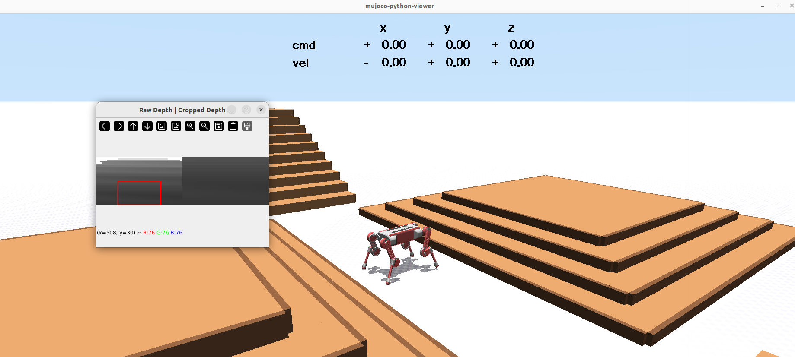

# Isaac_Lab_Roboparty
conda env
``` 
conda activate env_isaaclab_course
``` 


train 
``` 
python robolab/scripts/rsl_rl/train.py   --task BigReddog-Parkour   --headless   --num_envs=4096 --logger=tensorboard

``` 


play example 
``` 
python robolab/scripts/rsl_rl/play_parkour.py   --task=BigReddog-Parkour-Play   --num_envs=1   --checkpoint=/home/csl/Isaac_Lab_Roboparty/roboparty_train/logs/rsl_rl/bigreddog_parkour/2026-07-28_17-04-27/model_29999.pt
```


tensorboard 
``` 
tensorboard --logdir logs/rsl_rl/bigreddog_parkour --port 6006

``` 

sim2sim parkour_quadruped
``` 
 python robolab/scripts/mujoco/sim2sim_bigreddog_parkour.py \
 --depth_encoder logs/rsl_rl/bigreddog_parkour_amp/2026-07-31_20-32-21_amp_parkour_v1good/exported/0-depth_encoder.onnx \
 --actor logs/rsl_rl/bigreddog_parkour_amp/2026-07-31_20-32-21_amp_parkour_v1good/exported/actor.onnx \
 --scene stairs
``` 



amp+parkour


train
``` 
python robolab/scripts/rsl_rl/train.py \
  --task BigReddog-Parkour-AMP \
  --num_envs 4096 \
  --max_iterations 30000 \
  --run_name amp_parkour_box \
  --logger tensorboard \
  --headless
``` 

test
```
python robolab/scripts/rsl_rl/train.py \
  --task BigReddog-Parkour-AMP \
  --num_envs 1 \
  --max_iterations 30000 \
  --run_name amp_parkour_v1 \
  --logger tensorboard 
```


play

``` 
PYTHONPATH=/home/csl/Isaac_Lab_Roboparty/roboparty_train/robolab \

python scripts/rsl_rl/play_parkour.py \
  --task BigReddog-Parkour-AMP-Play \
  --num_envs 1 \
  --checkpoint /absolute/path/to/model_5000.pt
  ``` 