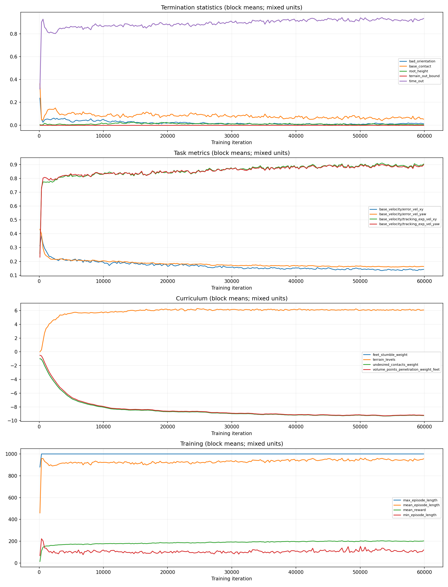
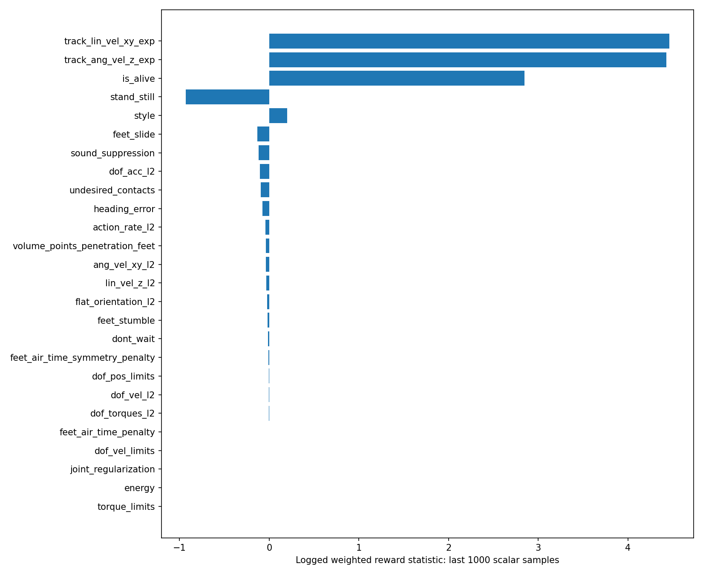

# Reward tuning and depth-to-action evaluation

## Scope and evidence

The requested `roboparty_train/logs/rsl_rl/bigreddog_parkour_amp1` directory was not present. This is a **provisional evaluation of a different, available run**: `bigreddog_parkour_amp/2026-10-01_17-20-28_amp_flat`. Do not attribute these results to amp1. Other available runs were inventoried but not compared quantitatively.

Evidence: TensorBoard scalar events, this run's saved `params/env.yaml` and `params/agent.yaml`, and current local policy/AMP implementation. Saved configuration takes precedence over current editable training configs. Current implementation explains the data flow but may differ from the historical training revision. No simulation rollout, checkpoint inference, or depth intervention was performed.

Analysis covers iterations 0–59,999. Table entries compare the first and final 1,000 recorded scalar samples, not independent evaluation episodes. These windows are descriptive; curriculum changes, environment mixtures, and correlated samples prevent causal claims or statistical confidence estimates.

## Main findings

The run improved velocity tracking and episode duration while progressing to more difficult terrain. Base contact remains the largest logged failure category. The logs do **not** establish that depth images caused the improvement or that the controller uses depth effectively.

| Logged metric | First window | Final window | Interpretation |
|---|---:|---:|---|
| Train/mean_reward | 107.80 | 200.84 | Increased task-return statistic; not a success rate |
| AMP/mean_total_reward | 33.90 | 63.01 | Separate mixed-return statistic |
| Mean episode length (steps) | 831.01 | 948.64 | Longer survival, near 1,000-step horizon |
| Mean terrain level | 1.23 | 6.09 | Evaluation difficulty changed during training |
| Velocity xy error metric | 0.328 | 0.141 | Improved logged tracking |
| Yaw velocity error metric | 0.342 | 0.163 | Improved logged tracking |
| Time-out termination statistic | 0.755 | 0.925 | More horizon completions; not terrain success |
| Base-contact termination statistic | 0.133 | 0.0595 | Largest remaining logged failure term |
| Bad-orientation termination statistic | 0.0882 | 0.0137 | Reduced orientation failures |
| Root-height termination statistic | 0.00634 | 0.00368 | Smaller residual issue |

Termination statistics are averaged logger values, not a pooled count of independently evaluated episodes; conditions may overlap. A time-out does not prove obstacle completion. The final-window mean of the minimum-episode-length statistic is only 107.55 steps: aggregate survival can hide difficult cases.

## Reward balance

The following are **logged weighted contributions**, not raw physical measurements or gradient influence:

| Reward term | Final-window mean |
|---|---:|
| Linear velocity tracking | +4.461 |
| Angular velocity tracking | +4.427 |
| Alive | +2.846 |
| Stand still | -0.932 |
| Feet slide | -0.135 |
| Sound suppression | -0.117 |
| Joint acceleration | -0.103 |
| Undesired contacts | -0.096 |
| Action rate | -0.0405 |
| Foot-edge volume penetration | -0.0395 |
| Feet stumble | -0.0190 |

Tracking and survival dominate the positive values. Stand-still is the largest negative value; inspect its command gating and raw error before changing it. Small mean foot-edge penalties can reflect rare events, successful avoidance, or dilution across terrain types—not necessarily an insufficient coefficient.

Foot-edge curriculum weight changes from a first-window mean of -0.946 to -9.202. Its weighted penalty increases from -0.0125 to -0.0395 while terrain difficulty also rises. This is **not evidence that raw penetration became worse**. Log unweighted penetration, incidence, and per-terrain results before drawing that conclusion. Avoid dividing window-averaged reward by window-averaged weight as an exact reconstruction of raw reward.

The saved AMP settings use `task_style_lerp=0.3`, `style_reward_scale=2.0`. Current implementation computes:

`training reward = 0.3 * task reward + 0.7 * style reward`

Style reward is masked to the four configured Perlin terrain names; current code still scales task reward by 0.3 when style reward is zero. The 0.7 multiplier does not mean style supplies 70% of actual return or learning influence: magnitudes and masks matter. This blend is not a depth-versus-proprioception control.

Despite the run name `amp_flat`, its saved terrain configuration includes gaps, stairs, slopes, and Perlin terrain. Do not report this as a flat-only experiment.

## How depth affects actions

The saved actor is `EncoderMoEActorCritic` with five experts and a 128-dimensional depth embedding. Current encoder code concatenates non-image policy observations with encoded depth before the actor:

`depth image -> convolutional encoder -> 128 features`

`[robot observations, commands, depth features] -> actor -> joint actions`

The saved action configuration is joint-position control with scale 0.25 and default-position offsets. In that configuration, the action-to-target mapping is approximately `q_target = q_default + 0.25 * action`; actuator dynamics then determine actual motion. Camera update period is 0.02 s. This alone does not verify effective end-to-end sensing latency.

There is no explicit depth/action ratio in these settings. Rewards train the policy to choose useful actions; they do not directly command the encoder to attend to obstacles. Strong tracking rewards can coexist with weak visual use if nonvisual cues suffice. This is a hypothesis to test, not a finding from these scalars.

The logs contain no synchronized depth/action samples or visual ablation results. The MoE expert-3 mean gate weight is about 0.032 versus 0.226–0.262 for most other experts; that asymmetry alone does not establish visual neglect or expert failure.

## Experiments needed to measure visual control

Use one fixed checkpoint, deterministic action means, fixed commands, matched seeds and initial states, and a frozen terrain distribution/curriculum. Keep friction and all physics identical. Evaluate each terrain separately and report results across multiple seeds.

1. **Offline paired sensitivity:** Record actual policy inputs. Hold every non-depth input fixed and compare real depth with a frozen frame, temporally delayed frame, or depth from a different terrain. Measure per-joint action RMS difference and corresponding target-angle difference (`0.25 * RMS action difference`). This tests dependence, not whether the response is beneficial.
2. **Closed-loop ablation:** Compare normal depth, frozen depth, delayed depth, and shuffled depth. Record obstacle completion, base contacts per episode/metre, slips, edge penetration, tracking error, action rate, and time to failure. Define completion geometrically, not by time-out.
3. **Robustness:** Repeat with controlled depth noise and latency. Constant/blank depth is an out-of-distribution intervention; a performance drop alone does not quantify normal visual usefulness.
4. **Timing:** Log camera timestamps, obstacle distance, actions, foot trajectories, and contact onset. Look for anticipatory foot motion before contact. Reactive recovery after collision is different from obstacle anticipation.

Interpretation: little action change plus little performance change suggests low visual dependence on the tested tasks. Large action change without performance benefit suggests sensitivity without demonstrated utility. Better normal-depth performance on matched obstacle trials is evidence of useful visual control.

## Controlled reward-tuning plan

These are proposed experiments, not validated optimal settings. First establish the visual baseline above; then change one factor at a time, retaining an unchanged control and equal training budgets.

| Experiment | Candidate change | What to measure / decision rule |
|---|---|---|
| Edge placement | 0.5x, 1x, 1.5x the baseline foot-edge weight schedule | Keep only if raw penetration and obstacle failures improve without increased hesitation |
| Contact avoidance | 1x versus 1.5x undesired-contact schedule | Base contacts per terrain, traversal completion, speed tracking; distinguish termination effects from reward effects |
| Action smoothness | action_rate weight -0.01, -0.02, -0.04 | Joint target rate and anticipatory stepping; stronger smoothing may delay needed corrections |
| Style/task balance | task_style_lerp 0.3 versus 0.5 | Compare terrain-stratified mixed/task/style returns and gait quality; reward scale also changes |
| Stationary behavior | Inspect stand-still command gating before tuning | Separate zero-command and moving-command performance |

Do not change action scale or depth feature scale as a substitute for reward tuning: that changes controller behavior/input distribution directly and confounds the comparison. Keep base-contact termination unchanged for the first comparison; removing it changes the task and episode distribution.

Prioritize base-contact diagnostics and terrain-specific depth tests over simply increasing the already curriculum-amplified edge penalty. The earlier pasted PLAY logs also showed base-contact termination, but they are separate evidence and have not been linked to this checkpoint.

## Report-ready conclusion

“Across 60,000 training iterations, the available run increased mean episode length from 831 to 949 steps and reduced the logged base-contact termination statistic from 0.133 to 0.059 while progressing to higher terrain levels. Velocity-tracking metrics improved. These aggregate results support improved task performance but do not establish effective use of depth imagery. Reward tuning should be evaluated with fixed terrain conditions, raw contact/penetration metrics, and matched depth-ablation rollouts. Base-contact failures are the first diagnostic priority.”

## Reproduction and files

Run `python reports/reward_tuning/analyze.py` from the repository. It reads scalar events without loading checkpoint objects or changing training files. `metrics.csv` and `summary.json` contain all extracted scalar summaries. The script targets the provisional run explicitly; change that path to the intended amp1 run when available. The simple event reader assumes intact TFRecord inputs and does not validate CRCs; final steps/counts were cross-checked with TensorBoard's EventAccumulator.
