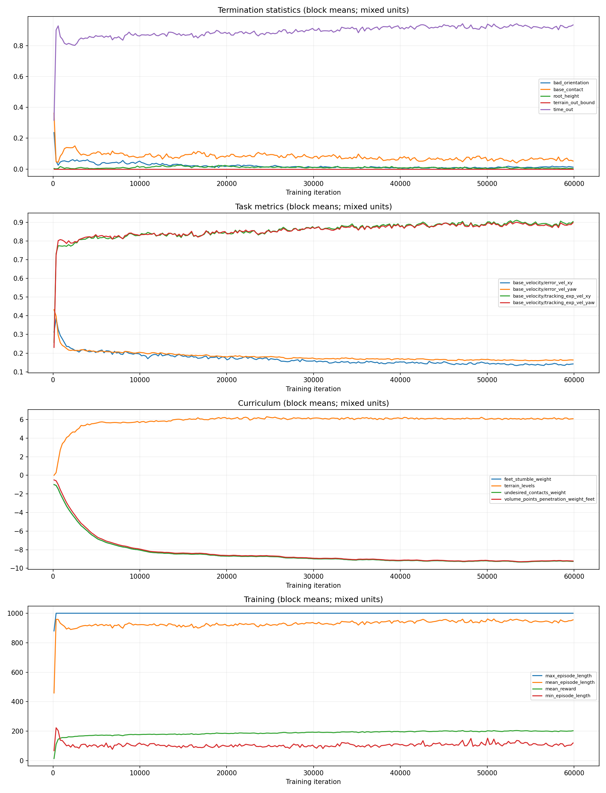
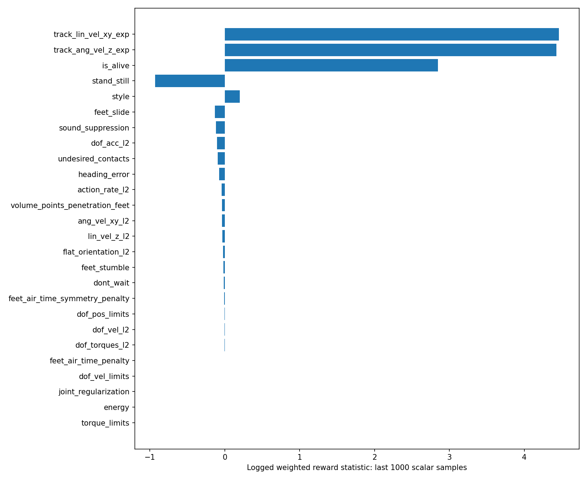

# 獎勵調整與深度影像對動作影響之評估報告

## 一、分析範圍與資料來源

原先指定的 `roboparty_train/logs/rsl_rl/bigreddog_parkour_amp1` 目錄不存在。本報告是針對另一個現有訓練紀錄的**暫定分析**：

`bigreddog_parkour_amp/2026-10-01_17-20-28_amp_flat`

**以下結果不能歸屬於 amp1。** 其他現有訓練紀錄僅進行目錄盤點，未做量化比較。

資料來源包括 TensorBoard 純量紀錄、該次訓練保存的 `params/env.yaml` 與 `params/agent.yaml`，以及目前工作目錄中的策略與 AMP 實作。分析設定以該次訓練保存的設定為準，而不是目前正在編輯的設定檔。目前程式碼用於解釋資料流程，但可能與當時訓練版本不同。本次未執行模擬評估、checkpoint 推論或深度影像干預實驗。

分析涵蓋第 0～59,999 次訓練迭代。表格比較各指標**最初與最後 1,000 筆純量紀錄的平均值**，並非 1,000 個獨立測試回合。由於課程學習、混合地形及樣本相關性，這些結果只能用於描述趨勢，不能直接推論因果關係或統計信心水準。

## 二、主要結果

隨著地形難度提高，速度追蹤與回合持續時間仍有所改善。機身接觸依然是紀錄中最主要的失敗類別。然而，**這些紀錄不能證明改善是由深度影像造成，也不能證明控制器有效利用了深度資訊。**

| 紀錄指標 | 初期平均 | 後期平均 | 解讀 |
|---|---:|---:|---|
| `Train/mean_reward` | 107.80 | 200.84 | 任務回報統計上升，不等於成功率 |
| `AMP/mean_total_reward` | 33.90 | 63.01 | 另一個混合回報統計，應與任務回報分開解讀 |
| 平均回合長度，單位：step | 831.01 | 948.64 | 存活時間增加，接近 1,000 step 上限 |
| 平均地形等級 | 1.23 | 6.09 | 訓練過程中的難度並非固定 |
| 平面速度追蹤誤差指標 | 0.328 | 0.141 | 紀錄中的追蹤表現改善 |
| 偏航角速度追蹤誤差指標 | 0.342 | 0.163 | 紀錄中的追蹤表現改善 |
| 時間到期終止統計 | 0.755 | 0.925 | 更多回合達到時間上限，不代表成功通過地形 |
| 機身接觸終止統計 | 0.133 | 0.0595 | 仍是主要失敗項目 |
| 姿態異常終止統計 | 0.0882 | 0.0137 | 姿態失敗減少 |
| 根部高度不足終止統計 | 0.00634 | 0.00368 | 剩餘問題較小 |

上述終止數值是紀錄器輸出的平均統計，並非將獨立評估回合重新計數後得到的整體比例；不同終止條件也可能同時觸發。時間到期不代表成功越過障礙物。此外，後期「最短回合長度」指標的平均值僅 107.55 step，顯示整體平均可能掩蓋困難案例。



## 三、獎勵項目之間的平衡

以下數值是**紀錄中的加權獎勵貢獻**，不是原始物理量，也不能直接代表各項對訓練梯度的影響大小。

| 獎勵項目 | 後期平均 |
|---|---:|
| 線速度追蹤 | +4.461 |
| 角速度追蹤 | +4.427 |
| 存活獎勵 | +2.846 |
| 靜止行為懲罰 `stand_still` | -0.932 |
| 腳部滑動 | -0.135 |
| 接觸衝擊抑制 `sound_suppression` | -0.117 |
| 關節加速度 | -0.103 |
| 非預期接觸 | -0.096 |
| 動作變化率 | -0.0405 |
| 腳部採樣點穿入邊緣虛擬障礙物 | -0.0395 |
| 腳部絆碰 `feet_stumble` | -0.0190 |

正向數值主要來自速度追蹤與存活獎勵。最大的負向項目是 `stand_still`，調整前應先檢查它在哪些速度命令下啟用，以及未加權的原始誤差。

腳部邊緣懲罰的平均值較小，可能是事件少、避障有效，或被其他地形樣本稀釋，不能直接判斷權重不足。

腳部邊緣懲罰的課程權重，從初期平均 **-0.946** 變成後期平均 **-9.202**；其加權懲罰則由 **-0.0125** 變為 **-0.0395**，同時地形難度也提高。**這不能證明原始穿入程度變嚴重。** 應額外記錄未加權的穿入量、發生頻率及各地形的結果。將平均獎勵除以平均權重，也不能精確還原原始獎勵。



保存的 AMP 設定為：

```python
task_style_lerp = 0.3
style_reward_scale = 2.0
```

目前程式的混合方式為：

```text
訓練獎勵 = 0.3 × 任務獎勵 + 0.7 × 動作風格獎勵
```

動作風格獎勵僅在設定的四種 Perlin 地形名稱上啟用。依目前實作，即使風格獎勵為零，任務獎勵仍乘以 0.3。**係數 0.7 不代表風格獎勵占實際回報或學習影響的 70%**，還需要考慮數值大小與地形遮罩。這個比例也不是「深度影像與本體感測資訊」的比例。

雖然訓練名稱為 `amp_flat`，保存設定中仍包含缺口、樓梯、斜坡與 Perlin 地形，因此不能將此實驗描述成純平地訓練。

## 四、深度影像如何影響動作

保存的策略模型為 `EncoderMoEActorCritic`，包含五個專家網路與 128 維深度影像特徵。目前編碼器程式會將非影像觀測與深度特徵串接，再輸入 actor：

```text
深度影像 → 卷積編碼器 → 128 維特徵

[機器人觀測、控制命令、深度特徵] → actor → 關節動作
```

保存的動作設定使用關節位置控制，`scale=0.25`，並加上預設關節位置偏移。因此動作到目標關節位置的關係約為：

```text
q_target = q_default + 0.25 × action
```

實際運動仍取決於致動器與機器人動力學。相機更新週期為 0.02 秒，但這個設定本身不能確認整個感測至控制流程的實際延遲。

**目前設定沒有直接控制「深度影像對動作影響比例」的參數。** 獎勵讓策略學習哪些動作有利，並不直接要求編碼器注意障礙物。如果非視覺資訊已足以完成任務，速度追蹤表現很好也可能伴隨很低的視覺依賴；這是需要驗證的假設，並非本次紀錄已證實的結果。

現有紀錄沒有同步保存的深度影像／動作樣本，也没有視覺消融實驗結果。MoE 的 expert-3 平均閘控權重約為 0.032，而多數其他專家約為 0.226～0.262；僅憑這種不均衡不能判斷模型忽略視覺或該專家失效。

## 五、如何量測視覺對控制的實際作用

固定同一個 checkpoint，使用確定性的動作均值，固定控制命令，配對隨機種子與初始狀態，並凍結地形分布及課程難度。各組使用相同摩擦與物理設定。依地形分開評估，並以多個隨機種子重複測試。

### 1. 離線配對敏感度測試

記錄策略實際輸入，固定所有非深度輸入，只將深度影像替換為凍結畫面、延遲畫面或其他地形畫面。量測各關節動作的均方根差異（RMS），以及對應的目標關節角度差異：

```text
目標角度 RMS 差異 = 0.25 × 動作 RMS 差異
```

這能量測策略是否依賴影像，但不能單独證明這種反應有益。

### 2. 閉迴路消融測試

比較正常深度、凍結深度、延遲深度與打亂的深度。記錄障礙物通過情況、每回合／每公尺機身接觸次數、滑動、邊緣穿入、速度追蹤誤差、動作變化率及失敗時間。

「成功通過」應由機器人是否跨越指定障礙區域判定，不能直接以回合時間到期當作成功。

### 3. 穩健性測試

加入可控制的深度雜訊與延遲，重複測試。固定值或空白深度可能偏離訓練資料分布，因此效能下降本身不能直接量化正常視覺資訊的價值。

### 4. 反應時序分析

記錄相機時間戳記、障礙物距離、動作、腳部軌跡與接觸開始時間，確認機器人是否在接觸前就調整抬腳或落腳。碰撞後恢復與碰撞前預判應分開評估。

結果可依以下方式解讀：

| 測試現象 | 可支持的判斷 |
|---|---|
| 替換影像後，動作與表現都幾乎不變 | 在受測任務中，視覺依賴可能較低 |
| 動作變化很大，但沒有表現上的好處 | 對影像敏感，但尚未證明有用 |
| 配對障礙物測試中，正常深度表現較好 | 支持視覺資訊對控制有實際幫助 |

## 六、獎勵調整實驗計畫

以下為**待驗證的實驗方案，不是已確認的最佳參數**。先建立上述視覺評估基準，再一次改一個因素，保留不變的對照組，並使用相同訓練預算。

| 實驗方向 | 候選調整 | 量測項目與判斷原則 |
|---|---|---|
| 邊緣落腳 | 基準腳部邊緣權重排程的 0.5、1、1.5 倍 | 原始穿入量與障礙物失敗減少，且沒有增加猶豫停滯，才保留調整 |
| 接觸避免 | 非預期接觸權重排程的 1 與 1.5 倍 | 比較各地形機身接觸、通過情況及速度追蹤；區分終止條件與獎勵效果 |
| 動作平滑 | `action_rate` 權重 -0.01、-0.02、-0.04 | 比較關節目標變化率與提前抬腳；過強平滑可能延遲必要修正 |
| 風格與任務平衡 | `task_style_lerp` 0.3 與 0.5 | 依地形比較混合／任務／風格回報及步態；此調整也改變獎勵尺度 |
| 靜止行為 | 先檢查 `stand_still` 的命令啟用條件 | 分開比較零速度命令與移動命令下的表現 |

不要用修改 action scale 或深度特徵尺度取代獎勵調整，因為這會直接改變控制行為或輸入分布，使比較難以解釋。第一輪比較也應維持原本的機身接觸終止條件；移除它會改變任務與回合分布。

建議先診斷機身接觸原因，並執行各地形的深度測試，再決定是否提高已由課程學習放大的邊緣懲罰。先前貼上的 PLAY 紀錄同樣顯示機身接觸終止，但屬於另一份證據，目前未確認它與這個 checkpoint 的關係。

## 七、可直接用於簡報的結論

> 在本次可取得的訓練紀錄中，經過 60,000 次迭代，平均回合長度由 831 提升至 949 step，機身接觸終止統計由 0.133 降至 0.059，同時平均地形等級提高，速度追蹤指標也有所改善。這些結果支持任務表現提升，但尚不足以證明策略有效利用深度影像。後續獎勵調整應在固定地形條件下，配合原始接觸／穿入指標與配對的深度消融測試進行。機身接觸失敗應列為優先診斷項目。

## 八、重現方式與檔案

在儲存庫根目錄執行：

```bash
python reports/reward_tuning/analyze.py
```

此程式讀取純量事件，不載入 checkpoint 物件，也不修改訓練檔案。

- [完整純量指標表](metrics.csv)
- [JSON 分析摘要](summary.json)
- [分析程式](analyze.py)
- [英文原版報告](REPORT.md)

分析程式目前明確指定上述暫定訓練紀錄；取得真正的 amp1 路徑後，需修改路徑並重新分析。簡易事件讀取器假設 TFRecord 完整，未驗證 CRC；最後迭代編號與樣本數已使用 TensorBoard 的 EventAccumulator 交叉檢查。
